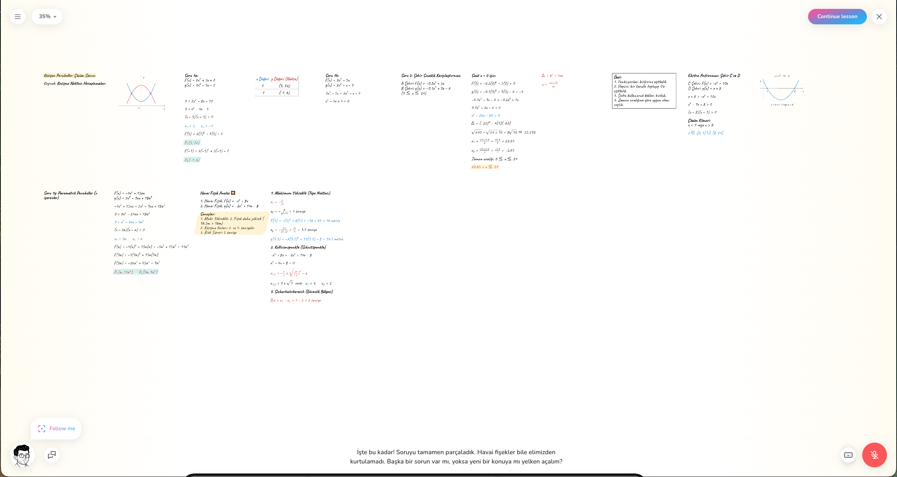
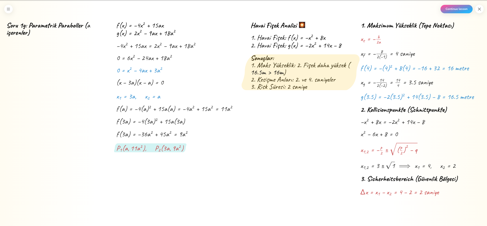
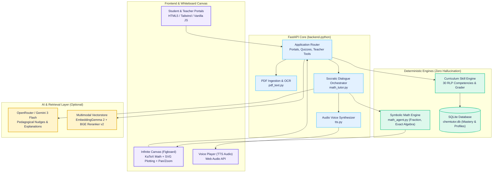
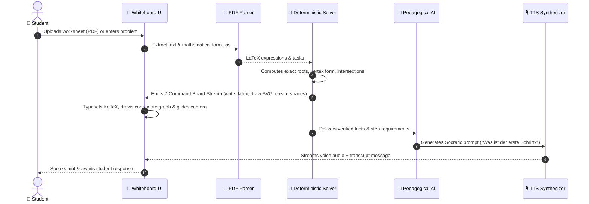

# 🏫 SchoolHack — AI-Powered STEM Learning & Infinite Whiteboard Tutor

> **Next-generation intelligent tutoring for STEM education (Klasse 9 Berlin Curriculum).**  
> Powered by a **deterministic symbolic math engine**, an **infinite interactive whiteboard**, **voice-synthesized Socratic tutoring**, and **multimodal textbook RAG**.

[](https://render.com/deploy?repo=https://github.com/aniloncul/SchoolHack/tree/main)
[](https://www.python.org/)
[](https://fastapi.tiangolo.com/)
[](LICENSE)
[](https://bildungsserver.berlin-brandenburg.de/)

---

## 🚀 The Pitch: Why SchoolHack?

Traditional AI chatbots (like ChatGPT or Claude) fail students in STEM:
1. **They hallucinate math:** LLMs predict text probabilistically. In multi-step algebra or chemistry stoichiometry, they frequently hallucinate arithmetic errors or write mathematically invalid steps.
2. **They rob the "Aha!" moment:** Typical chatbots give the final answer immediately, doing the student's homework instead of teaching.
3. **They lack visual pedagogy:** Real tutoring happens on a blackboard or worksheet with diagrams, highlighted terms, and step-by-step annotations.

### The SchoolHack Solution: *Zero-Hallucination AI Tutoring*

SchoolHack solves this by separating **computation** from **pedagogy**:
* **The Math & Chemistry Engines are Deterministic:** Every calculation, quadratic equation, intersection point, vertex, and chemical balance is computed with exact symbolic algorithms (using Python `Fraction` and curriculum graph rules). **The AI model never computes numbers.**
* **The AI is Strictly a Socratic Tutor:** The LLM acts purely as the patient teacher who observes the student's attempts, provides nudges without spoiling answers, and speaks naturally via Text-to-Speech (TTS).
* **The Infinite Whiteboard Brings Math to Life:** An interactive, pannable and zoomable canvas renders exact KaTeX formulas, dynamic SVG plots, and guided steps synchronized with live voice narration.

---

## 🎬 Live Demonstration: The Interactive Mathematik-Agent

Experience step-by-step mathematical learning on a digital blackboard. Upload a PDF homework worksheet or enter equations directly; the agent extracts the problems, computes exact proofs, plots dynamic graphs, and teaches you step-by-step with voice and text.

### 📹 Video Showcase

<!-- Video Player: Drop your video recording into docs/videos/math-agent-demo.mp4 or link your YouTube/Loom demo -->
<div align="center">
  <video src="docs/videos/math-agent-demo.mp4" width="100%" max-width="850px" controls autoplay loop muted poster="screenshots/math-agent-whiteboard.png">
    <p>Your browser does not support HTML5 video. <a href="docs/videos/math-agent-demo.mp4"><b>▶️ Click here to download or view the demo video</b></a>.</p>
  </video>
  <p><i>Walkthrough: Automatic PDF problem extraction &rarr; Deterministic calculation &rarr; Live whiteboard rendering &rarr; Voice-guided tutoring.</i></p>
</div>

> **Note on Video File:** To view the embedded video locally or in hosting environments, place your video capture at [`docs/videos/math-agent-demo.mp4`](docs/videos/). You can also watch or download recorded walkthrough sessions in [`rea-runs/studdyai/`](rea-runs/studdyai/).

---

### 📸 Whiteboard in Action

<div align="center">
  
  <p><b>Figure 1:</b> <i>Interactive whiteboard with KaTeX equation breakdowns, coordinate system visualization, auto-following camera, and real-time step explanations.</i></p>
</div>

<div align="center">
  
  <p><b>Figure 2:</b> <i>Multi-space layout: structured task columns (Problem &rarr; Derivation &rarr; Visuals &rarr; Result) with real-time TTS audio playback.</i></p>
</div>

---

## 🌟 Key Features

### 1. 🧮 Interactive Mathematik-Agent
* **Automated PDF Extraction (`pdf_text.py`):** Drag and drop your homework PDF. SchoolHack parses the document, normalizes OCR anomalies, isolates individual math tasks, and renders LaTeX equations.
* **Exact Deterministic Math Solver (`math_agent.py`):**
  * Solves linear and quadratic equations ($ax^2 + bx + c = 0$).
  * Computes exact parabola intersections ($f(x) = g(x)$), roots, and vertex forms ($S(d|e)$).
  * Handles parametric systems with parameter $a$ (e.g. $-4x^2 + 15ax = 2x^2 - 9ax + 18a^2$).
  * Analyzes domain-restricted inequalities (e.g. $-0.1x^2 + 3x - 6 > -0.2x^2 + 5x$ on $0 \le x \le 24$).
  * Uses arbitrary-precision `Fraction` math to avoid floating point inaccuracies.
* **Infinite Pannable & Zoomable Whiteboard (`mathematik.html`):**
  * Smooth pan and zoom from 30% to 200%.
  * **Auto-Follow Camera ("Folgen"):** The camera automatically glides and frames newly written equations.
  * Native KaTeX typesetting and mathematical coordinate systems rendered in crisp vector SVG.
* **Voice-Driven Socratic Tutor (`math_tutor.py` & `tts.py`):**
  * Generates audio voice narration for every instructional turn.
  * Follows pedagogical guidelines: encourages self-correction, gives tiered hints, and never speaks the final answer prematurely.

### 2. 🧪 ChemTutor & Science Platform (Klasse 9 Berlin)
* **Curriculum Skill Graph:** 30 competency nodes based on the Berlin Rahmenlehrplan (RLP) covering atomic models, chemical bonds, reactions, acids & bases, and stoichiometry.
* **Smart Diagnostic Testing Engine:** Generates randomized 30-question diagnostic quizzes with targeted trap detection for common student misconceptions.
* **Student Mastery Profile:** Tracks individual concept mastery. Right answers close the competency gap; mistakes trigger targeted remedial rounds.

### 3. 👩‍🏫 Teacher Superpowers & Classroom Analytics
* **One-Click Gap Finder:** Instantly analyzes test scores across the entire class to surface hidden conceptual blockers.
* **Support Grouping:** Automatically groups students who share identical conceptual gaps for targeted small-group instruction.
* **Mastery Radar & Heatmaps:** Multi-subject radar visualization across Chemistry, Mathematics, Physics, and Biology.

### 4. 📚 Multimodal Fokus Chemie RAG v2
* **Hybrid Retrieval:** BM25 lexical search combined with Google `EmbeddingGemma 2` and BAAI `bge-reranker-v2-m3`.
* **Multimodal Indexing:** 729 text chunks and 162 textbook figures with vision gating—guaranteeing answers are grounded in the official textbook.

### 5. 🌐 Full Bilingual Architecture (German & English)
* Instant **DE | EN** language toggle in the navigation bar.
* Client-side text mapping preserves grading logic while translating questions, explanations, and LLM prompts on the fly.

---

## 🏛️ System Architecture

SchoolHack is built as a clean, modular Python application using FastAPI, Jinja2 templates, modern ES6, and SQLite, with optional AI acceleration.



---

### How the Mathematik-Agent Works (Protocol Flow)



### The 7-Command Whiteboard Protocol

The math agent controls the infinite whiteboard via an event-driven command stream:
1. `clear_board`: Resets canvas spaces for a new exercise.
2. `create_space(id, title)`: Creates structured columns (`aufgabe`, `loesung`, `grafik`).
3. `write_latex(space, expr)`: Renders KaTeX mathematical formulas into the target space.
4. `write_text(space, text)`: Appends descriptive notes and intermediate steps.
5. `draw(space, type, data)`: Dynamically generates Cartesian coordinate systems and parabolic curves in SVG.
6. `focus_camera(target)`: Animates the viewport to highlight the current step.
7. `speak(text)`: Synthesizes accompanying speech for voice-guided learning.

---

## ⚡ Quick Start & Installation

### Option 1: 1-Click Deploy to Cloud (Free)

Deploy instantly to Render:

[](https://render.com/deploy?repo=https://github.com/aniloncul/SchoolHack/tree/main)

---

### Option 2: Run Locally (macOS, Linux, Windows)

#### Prerequisites
* **Python 3.10+** (`python3 --version` or `python --version`)
* **OpenRouter API Key** *(Optional — without a key, the deterministic solver and built-in pedagogical fallbacks work completely)*

#### Steps

1. **Clone the repository:**
   ```bash
   git clone https://github.com/aniloncul/SchoolHack.git
   cd SchoolHack
   ```

2. **Navigate to the application folder and set up environment:**
   ```bash
   cd backend-python

   # On macOS / Linux:
   python3 -m venv .venv
   source .venv/bin/activate

   # On Windows:
   python -m venv .venv
   .venv\Scripts\activate
   ```

3. **Install dependencies:**
   ```bash
   pip install -r requirements.txt
   ```

4. **Configure your environment (API Key):**
   ```bash
   cp .env.example .env
   ```
   Open `.env` and set your key:
   ```env
   OPENROUTER_API_KEY=sk-or-v1-your-key-here
   ```

5. **Start the application:**
   ```bash
   python -m uvicorn app.main:app --reload --port 8000
   ```
   *(Or simply run `./run.sh` on macOS/Linux or `run.bat` on Windows).*

6. **Open in browser:**
   Open [http://localhost:8000](http://localhost:8000).

---

### Option 3: Full Stack Demo with Multimodal RAG

To start both the **FastAPI Application** (port 8000) and the **Fokus Chemie RAG Server** (port 8080):

```bash
./setup.sh      # Installs all requirements and sets up venvs
./run_demo.sh   # Launches both RAG (:8080) and SchoolHack (:8000)
```

---

## 🔑 Demo Accounts

Use the pre-seeded accounts to explore both viewpoints:

| Role | Username | Password | Key Highlights |
|---|---|---|---|
| **Student** | `admin` | `admin` | **Mathematik-Agent**, Chemistry Quizzes, Personal Mastery Radar |
| **Teacher** | `admin` | `admin` | **Classroom Analytics**, 1-Click Gap Finder, Support Groups |

---

## 📂 Project Structure

```
SchoolHack/
├── backend-python/                 # Core application backend
│   ├── app/
│   │   ├── main.py                 # FastAPI application, routing & session handlers
│   │   ├── math_agent.py           # Deterministic symbolic math solver & board commands
│   │   ├── math_tutor.py           # Socratic dialogue tutor and turn manager
│   │   ├── pdf_text.py             # PDF parsing, OCR normalization & task extraction
│   │   ├── tts.py                  # Text-to-Speech audio synthesizer
│   │   ├── i18n.py                 # Language localization handler (German/English)
│   │   ├── templates/              # Jinja2 HTML templates
│   │   │   ├── mathematik.html     # Infinite whiteboard frontend UI
│   │   │   ├── base.html           # Core layout & navigation
│   │   │   └── ...                 # Student, teacher, and quiz views
│   │   └── static/                 # CSS, KaTeX bundle, i18n dictionaries, JS
│   ├── requirements.txt            # Python dependencies
│   └── run.sh                      # One-click startup script
│
├── vectorstore/                    # Multimodal RAG v2
│   ├── rag_v2/                     # Hybrid search (EmbeddingGemma 2 + BM25 + BGE Reranker)
│   ├── processed_data_v2/          # Pre-indexed Chroma vector database & textbook images
│   └── requirements.txt            # Vector store dependencies
│
├── screenshots/                    # High-res UI & whiteboard screenshots
│   ├── math-agent-whiteboard.png   # Full view of the active mathematics whiteboard
│   └── studdyai-canvas.png         # Multi-space canvas layout
│
├── docs/                           # Architectural & deployment documentation
│   ├── videos/                     # Demo video directory
│   ├── technical-flow.md           # Runtime technical architecture & sequence flows
│   ├── business-flow.md            # Educational value proposition & student journey
│   └── DEPLOY_RENDER.md            # Production deployment instructions
│
├── studdyai-re/                    # Reverse-engineering research & analysis
│   ├── matematik-ajan-uretim-raporu.md # Technical reconstruction report
│   ├── live-protocol.md            # Live WebSocket protocol specification
│   └── api-inventory.md            # Verified endpoint inventory
│
├── run_demo.sh                     # Launch both App and RAG servers
└── setup.sh                        # Automated environment setup script
```

---

## 📖 Deep Dives & Documentation

* [Technical Flow & Architecture](docs/technical-flow.md) — Comprehensive sequence diagrams and data flow.
* [Business Flow & Pedagogical Design](docs/business-flow.md) — How SchoolHack creates measurable learning outcomes.
* [Mathematik-Agent Reconstruction Report](studdyai-re/matematik-ajan-uretim-raporu.md) — Production analysis of live whiteboard tutoring.
* [Deploy on Render Guide](docs/DEPLOY_RENDER.md) — Cloud setup and production configuration.

---

## 📄 License

This project is open source and available under the [MIT License](LICENSE).
